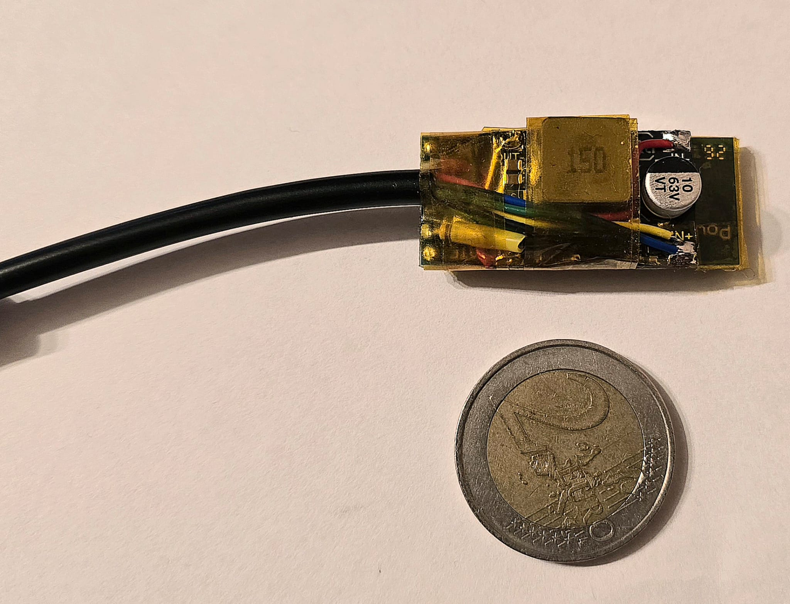
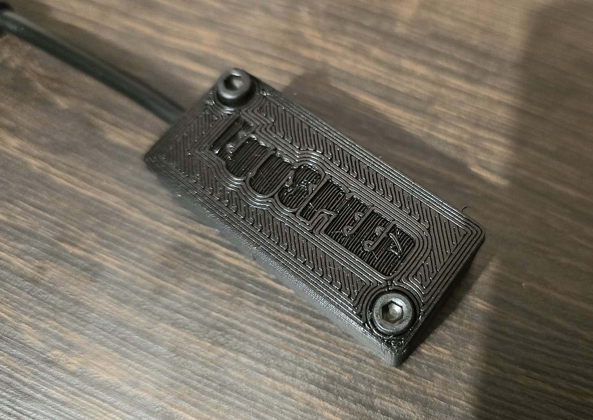
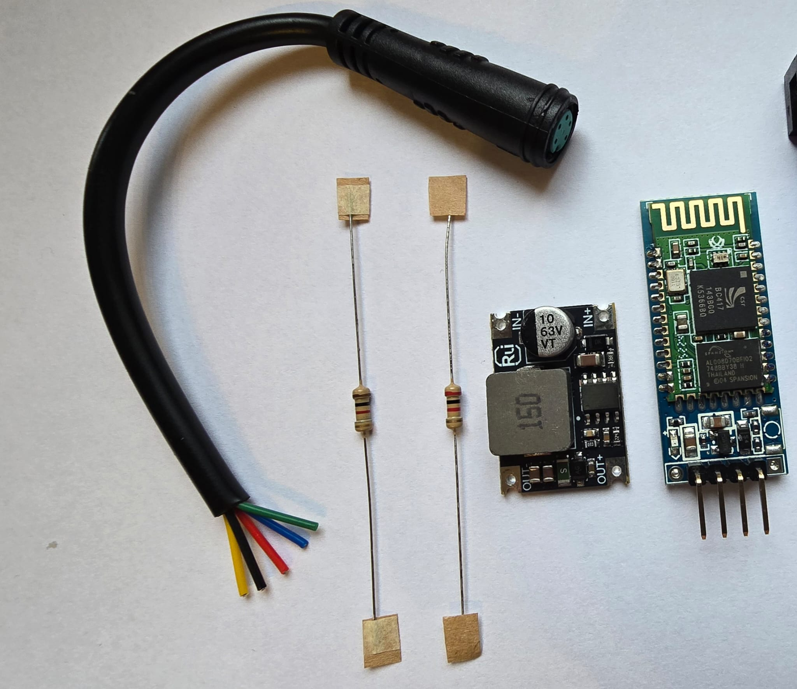
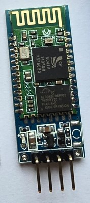
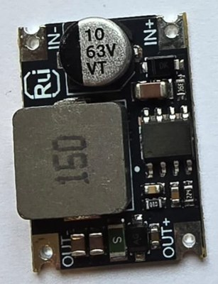
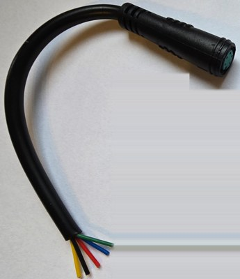
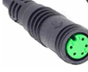
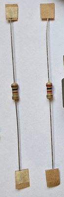
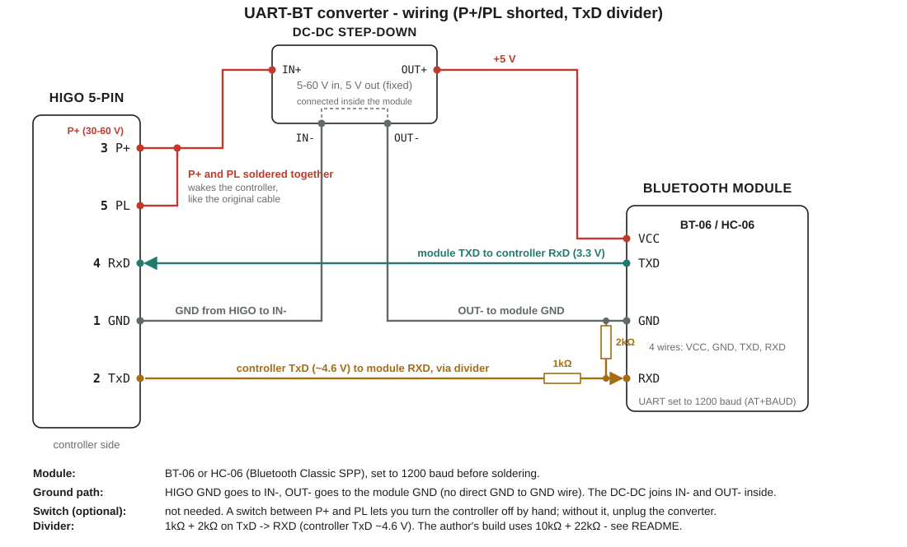
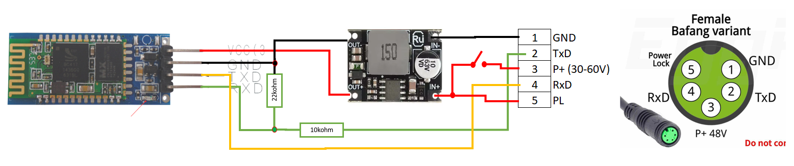

# UART-BT Converter

A small DIY Bluetooth converter for Bafang BBS mid-drive controllers. It plugs into the
controller's HIGO 5-pin display/programming connector and replaces the USB OTG programming
cable, so the [EggSPEED](https://github.com/moskil2/EggSPEED) Android app connects to the
controller over Bluetooth - no cable between the phone and the bike.

**Status: built and tested.** Works with EggSPEED v0.6.1 or newer over Bluetooth - reading,
programming and the live Cockpit - on OEM Bafang firmware and on BBS-FW (tested on a BBSHD).

 

This page is a step-by-step guide to building your own.

## How it works

<p align="center">
  <a href="https://www.youtube.com/watch?v=2S8ZIboOqes"></a>
  <br>
  <a href="https://www.youtube.com/watch?v=2S8ZIboOqes"><b>▶ Watch the video</b></a>
</p>

Normally EggSPEED talks to the controller through the USB OTG programming cable, with the phone
plugged into the bike. The converter replaces that cable: it stays plugged into the controller,
and the phone talks to it over Bluetooth. All communication between the app and the controller
goes over Bluetooth - there is no cable between the phone and the bike at all.

Everything EggSPEED can do over the cable works the same way over Bluetooth: you can read and
program the controller settings, and use the Cockpit with the live speed, power, current,
voltage, battery and all the other parameters while riding.

The converter is small (about the size of the Bluetooth module itself), gets its power from the
bike's battery through the controller connector, and needs no battery or charging of its own.

## What you need



| Part | Photo | Notes |
|---|---|---|
| **DSD TECH BT-06** Bluetooth module |  | Bluetooth Classic (SPP), 3.6-6V supply, 3.3V logic. Uses 4 pads: VCC, GND, TXD, RXD. A generic **HC-06** works the same way. |
| **Step-down converter** 5-60V in, 5V out |  | Fixed 5V output, 4 pads IN+/IN-/OUT+/OUT-, input rated for at least the full battery voltage. Non-isolated type (IN- and OUT- connected inside - check with a multimeter). |
| **Cable with a HIGO 5-pin plug** |   | Must mate with the controller-side connector (the one the display or the programming cable plugs into). |
| **Resistors** |  | For the TxD divider - see [The divider](#the-divider) below. |
| Thin wire, heat-shrink tubing, Kapton tape | | |

Tools: soldering iron, multimeter.

For programming the module once (Step 1): the Bafang USB programming cable (OTG cable), a Windows
PC and 4 jumper wires.

## HIGO pinout (controller side)

| Pin | Function | Notes |
|---|---|---|
| 1 | GND | |
| 2 | TxD | controller transmits, 5V logic |
| 3 | P+ | **battery voltage (30-60V), live even when the controller is off** |
| 4 | RxD | controller receives, 3.3V logic is enough |
| 5 | PL | "Power Lock" - connecting it to P+ wakes the controller |

**Go by pin numbers, never by wire colors.** Cables with HIGO plugs use different wire colors -
on some, even GND is red. Check every wire against the pin number with a multimeter (continuity)
before soldering.

## Wiring diagram



```
P+  (pin 3) ─┬─ PL (pin 5)          (soldered together)
             └─ step-down IN+
GND (pin 1)           -> step-down IN-
step-down OUT+ (5V)   -> BT-06 VCC
step-down OUT-        -> BT-06 GND
TxD (pin 2)           -> R1 (series) -> BT-06 RXD
                         R2 from BT-06 RXD to GND
RxD (pin 4)           <- BT-06 TXD (directly)
```

The same circuit drawn on photos of the real parts - this drawing also shows the optional
switch (see below):



**Optional switch.** If you want to turn the controller off by hand without unplugging the
converter, put a small ON/OFF switch in the P+ line - between HIGO pin 3 and the point where P+,
PL and the step-down IN+ meet. Switched off, it turns off both the controller and the module. It
is not needed for the converter to work.

### The divider

The controller's TxD is a 5V logic output, while the BT-06 RXD input is a 3.3V input (it accepts
at most about 3.7V and needs at least about 2.3V to see a logic "1"). The two resistors scale the
signal down:

- **R1 = 10kΩ** in series, from HIGO pin 2 (TxD) to the BT-06 RXD;
- **R2 = 22kΩ** from the BT-06 RXD to GND.

This is the divider the converter was tested with: the BT-06 RXD idles at **2.95V**, and the link
works reliably. Do not use the 1kΩ/2kΩ divider often shown for HC-06 modules - see
[Why 10kΩ/22kΩ and not 1kΩ/2kΩ](#why-10k22k-and-not-1k2k) at the bottom of this page.

Measure **BT-06 RXD against GND** with the converter plugged in and the controller idle: it should
read about **2.5-3.3V**. Below that the module may not see the controller's replies; above 3.7V
it is out of the module's spec.

## Step 1: Program the BT-06

The module has to be set to 1200 baud (and given a name, and optionally a new PIN) before it can
talk to the controller. This is done once, from a Windows PC, with the Bafang programming cable
you already have.

**[Manual 1 - Program the BT-06 with the OTG cable](docs/01-program-bt06.md)**

## Step 2: Build the converter

**[Manual 2 - Build and solder the converter](docs/02-build-and-solder.md)** - step by step,
with photos.

In short:

1. Check with a multimeter that the step-down converter's IN- and OUT- are connected.
2. **Power:** HIGO pin 3 (P+) and pin 5 (PL) soldered together, to step-down IN+. HIGO pin 1
   (GND) to step-down IN-.
3. **Module power:** step-down OUT+ to BT-06 VCC, OUT- to BT-06 GND.
4. **Controller to module:** HIGO pin 2 (TxD) through R1 to BT-06 RXD; R2 from BT-06 RXD to GND.
5. **Module to controller:** BT-06 TXD directly to HIGO pin 4 (RxD).
6. Insulate everything - P+ is battery voltage.

## Step 3: Connect EggSPEED

1. Plug the converter into the controller (battery connected). The controller wakes up and the
   BT-06 LED starts blinking.
2. On the phone: **Settings > Bluetooth**, pair **EggSPEED-BT** (PIN `1234`, or your own PIN
   from Manual 1).
3. In EggSPEED: **Settings > Connection type > Bluetooth**, pick **EggSPEED-BT** from the list of
   paired devices (allow the Bluetooth permission when asked).
4. Go to the **Connect** tab and tap **Connect**. The first connection can take a few seconds.

The converter can stay plugged in on the bike. While it is plugged in, the controller stays
awake and the converter draws a little power, so after riding it is best to turn the battery
off with its own switch.

## Troubleshooting

- **The phone sees EggSPEED-BT but the connection fails ("read failed"):** unplug the converter
  for about 10 seconds, plug it in again, and retry. If it still fails, remove the pairing in
  the phone's Bluetooth settings and pair again.
- **Connected, but the controller does not answer:**
  - check TX/RX: controller TxD (pin 2) goes to the module **RXD**, controller RxD (pin 4) to the
    module **TXD**;
  - measure the RXD level (see [The divider](#the-divider));
  - make sure the module was set to 1200 baud ([Manual 1](docs/01-program-bt06.md), step 7).
## Safety

- **P+ is the full battery voltage** and is live even with the controller switched off. Insulate
  everything and never let P+ touch the signal pins.
- **Turn the battery off with its switch** after riding: the converter keeps the controller awake
  and draws a little power for as long as the battery is on.
- **Change the default PIN** (Manual 1, step 6): with `1234`, anyone nearby could pair with the
  converter while the battery is on.

## Files

| File | What it is |
|---|---|
| [`docs/01-program-bt06.md`](docs/01-program-bt06.md) | Manual 1 - programming the BT-06 with the OTG cable |
| [`docs/02-build-and-solder.md`](docs/02-build-and-solder.md) | Manual 2 - building and soldering the converter |
| `diagram_v3.svg` | Wiring diagram |
| `Schemat_Hybrydowy_V3.PNG` | Wiring drawn on photos of the real parts (with the optional switch) |
| `HC-06.PNG` | HC-06 module (same family as the BT-06) |
| `DC-DC_StepDown_DC5-60V_5V.PNG` | The step-down converter |
| `Wtyczka_HIGO5.png` | HIGO 5-pin connector |
| `Higo5.PNG` | HIGO 5-pin plug (female), pin numbers and functions |
| [`archive/`](archive/ARCHIVE.md) | Earlier design variants and research notes (project history) |

## Why 10k/22k and not 1k/2k

The first version of the converter used a 1kΩ/2kΩ divider - the values usually shown for
connecting an HC-06 module to a 5V Arduino. On the Bafang controller it left almost no margin:

- the controller's TxD (HIGO pin 2) is not a strong output - loaded by 1kΩ + 2kΩ, it dropped to
  **3.5V** (measured on pin 2);
- the divider then gave about 3.5V × 2/3 ≈ **2.3V** on the BT-06 RXD - exactly the module's
  minimum level for a logic "1", with no safety margin.

A 10kΩ/22kΩ divider has about the same ratio, but loads the controller's TxD about ten times
less, so the signal no longer sags. With it, the BT-06 RXD idles at **2.95V** (measured) and the
controller's replies come through reliably. At 1200 baud the higher resistor values have no
effect on the signal timing.
