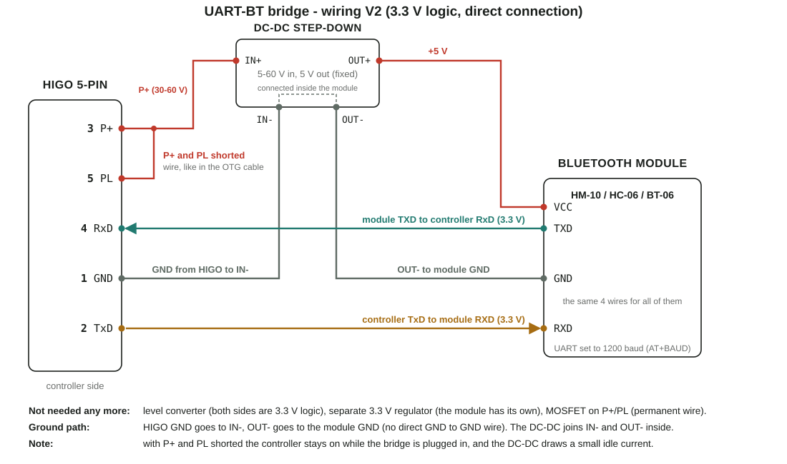
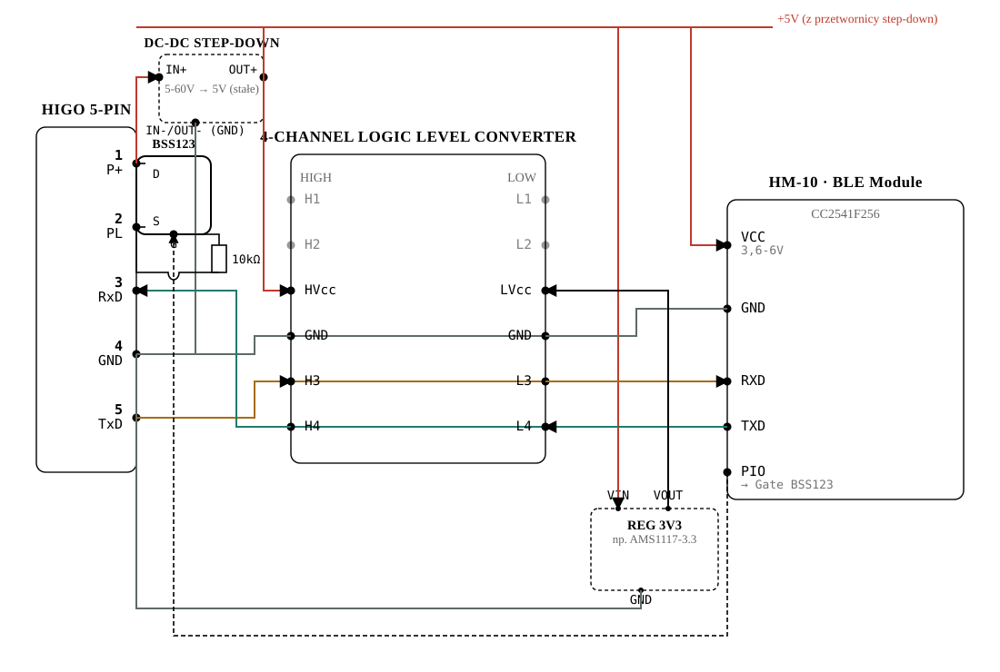
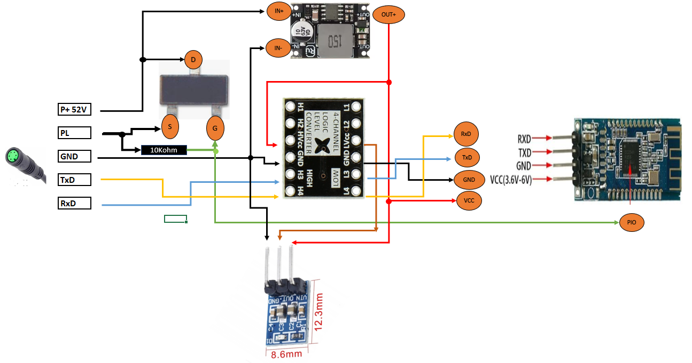
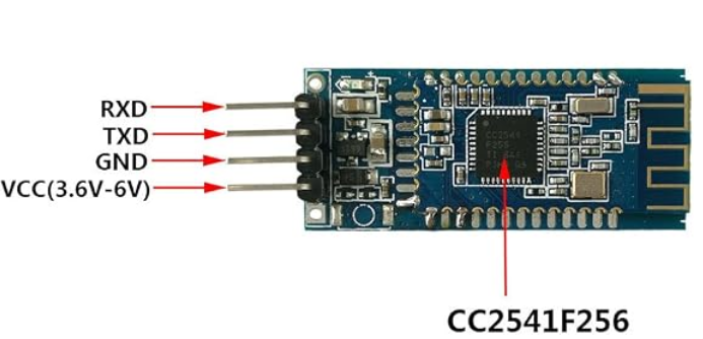
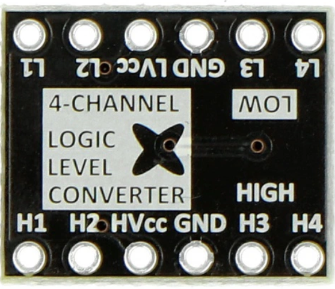
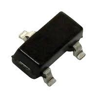
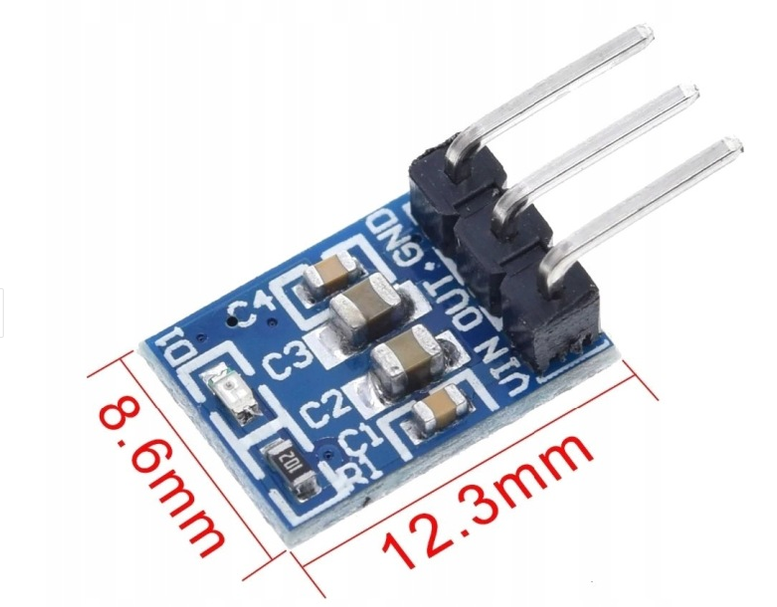
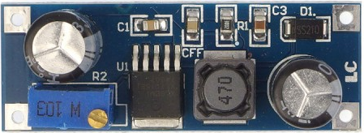
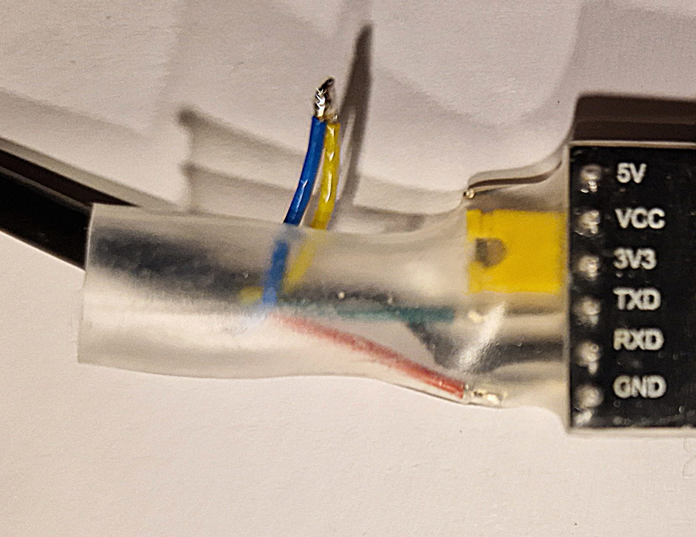
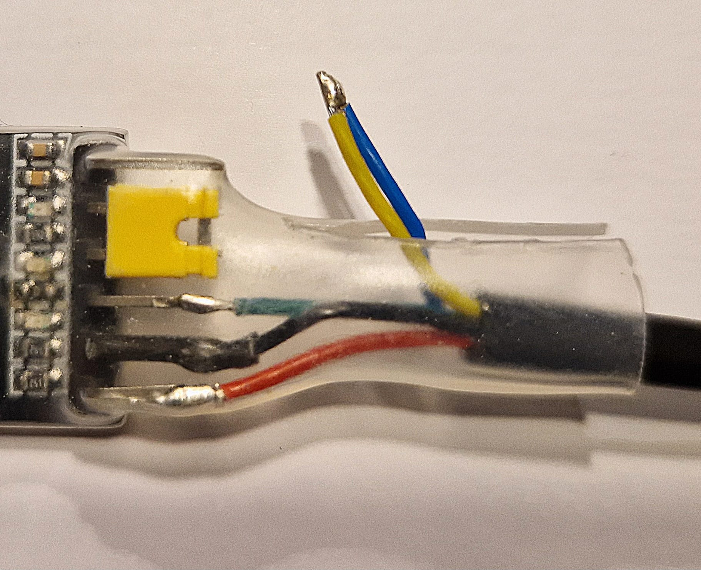

# Archive - earlier design variants

This folder keeps the earlier design stages of the converter as project history. None of it is
needed to build the converter - the current build guide is in the [main README](../README.md).

## Variant V2 - no divider on TxD

The step before the current design. P+ and PL shorted, like today, but the controller TxD went to
the module RXD directly, without a divider.



```
P+ (pin3, 30-60V)    -> shorted to PL (pin5), like in the original OTG cable
P+ (pin3)            -> step-down IN+
GND (pin1)           -> step-down IN-
step-down OUT-       -> BT module GND
step-down OUT+ (+5V) -> BT module VCC
TxD (pin2)           -> BT module RXD (directly)
RxD (pin4)           <- BT module TXD (directly)
```

The controller TxD idles at about 4.6 V, above what the module input accepts, so the divider was
added in the current design.

## Variant V1 - HM-10 with a level shifter and a MOSFET switch

The first design, before the controller logic levels were known. It assumed an HM-10 (Bluetooth
Low Energy) module, a 4-channel BSS138 logic level shifter with its own 3.3V regulator, and a
BSS123 MOSFET in place of the P+/PL wire, driven by the HM-10 PIO pin, so the app could switch
the controller on and off remotely.



Hybrid diagram of V1, drawn on photos of the real boards:



Interactive version (in Polish): [`bt-bridge-wiring.html`](bt-bridge-wiring.html).

Note: V1 diagrams use an old, **wrong** HIGO pin numbering (1=P+, 2=PL, 3=RxD, 4=GND, 5=TxD).
The correct numbering is in the main README.

```
P+ (30-60V)          -> step-down IN+                          -> BSS123 Drain
step-down OUT+ (+5V) -> level shifter HVcc -> HM-10 module VCC (directly)
                     -> 3.3V regulator VIN (e.g. AMS1117-3.3) -> level shifter LVcc
GND                  -> common ground
TxD                  -> H3 -> L3 -> RXD (HM-10)
RxD                  <- H4 <- L4 <- TXD (HM-10)
PL                   <- BSS123 Source
BSS123 Gate          <- PIO (HM-10), directly
BSS123 Gate          -> R ~10kΩ -> PL (pull-down, OFF by default)
```

Why it was dropped: the original programming cable showed that the controller talks 3.3V logic
in the module-to-controller direction, so the level shifter and the regulator were not needed.
The MOSFET switch needs a module with a programmable output pin (HM-10), and HM-10 uses Bluetooth
Low Energy, which EggSPEED does not support. A simple mechanical switch does the same job.

### V1 parts

| Part | Photo | Notes |
|---|---|---|
| **HM-10** |  | BLE module, CC2541F256 chip. Pins: RXD, TXD, GND, VCC (3.6-6V), PIO. Talks over GATT in small packets, not as a serial port - not supported by EggSPEED. |
| **Logic level shifter** |  | 4-channel, BSS138-based, two rails: HVcc (5V) and LVcc (3.3V). |
| **BSS123 MOSFET** |  | N-channel, logic-level, SOT-23, 100V/0.17A. Drain to P+, Source to PL, Gate from the HM-10 PIO, ~10kΩ Gate-to-PL pull-down. |
| **3.3V regulator** |  | E.g. AMS1117-3.3, powered the level shifter's LVcc. |
| **XL7015 step-down** |  | Rejected step-down candidate, replaced by the fixed 5-60V to 5V module. |

Current on the P+/PL line, for sizing the switch: the Bafang DPC18 display is specified at 10mA
rated, 30mA max operating current, <1µA standby, 50mA supply to the controller
([california-ebike.com](https://california-ebike.com/products/bafang-color-display-dpc18)).

Rejected P+/PL switch options:

- **NTR4170N** - only 30V, too low for a 36-52V battery.
- **Relay modules "10A 250VAC/10A 30VDC"** - the 30VDC rating is too low (P+ can reach ~58V).
- **Reed relay** - rejected in favor of the MOSFET (smaller, isolation not needed).

## Original programming cable, taken apart

| | |
|---|---|
|  |  |

Inside is a plain USB-UART board (pins 5V, VCC, 3V3, TXD, RXD, GND) with a VCC-3V3 jumper, so it
talks to the controller on 3.3V logic. Only TXD, RXD and GND go to the HIGO plug; P+ and PL are
soldered together separately - this is what wakes the controller without a display.

## HIGO pin numbering - how the early mistake happened

Early documents used the numbering 1=P+, 2=PL, 3=RxD, 4=GND, 5=TxD, taken indirectly from a forum
thread. It was wrong. The two mating halves of the connector - controller side and display side
([`Higo5.PNG`](../Higo5.PNG), reference only) - have position numbers that look mirrored when you
compare the photos, which caused the confusion. The correct controller-side numbering is in the
main README and was confirmed with a continuity test on a real cable.

## Research notes

The full research log from the design stage, in Polish: [`research.md`](research.md).
