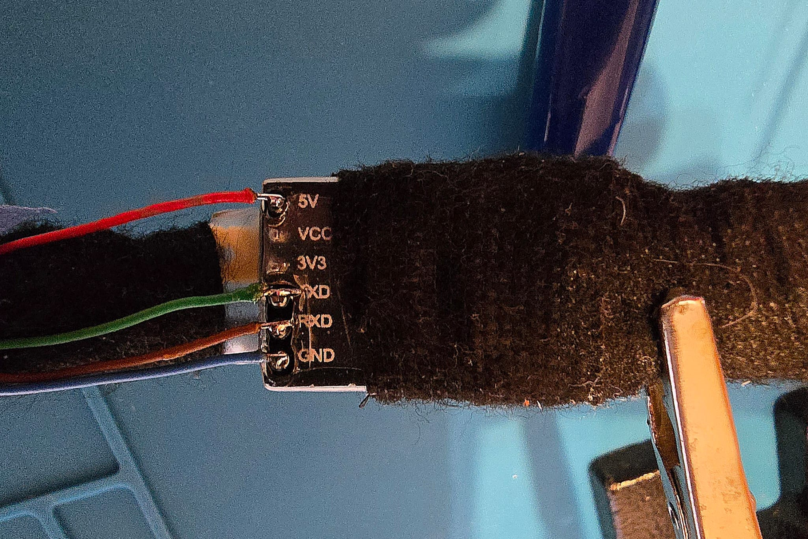
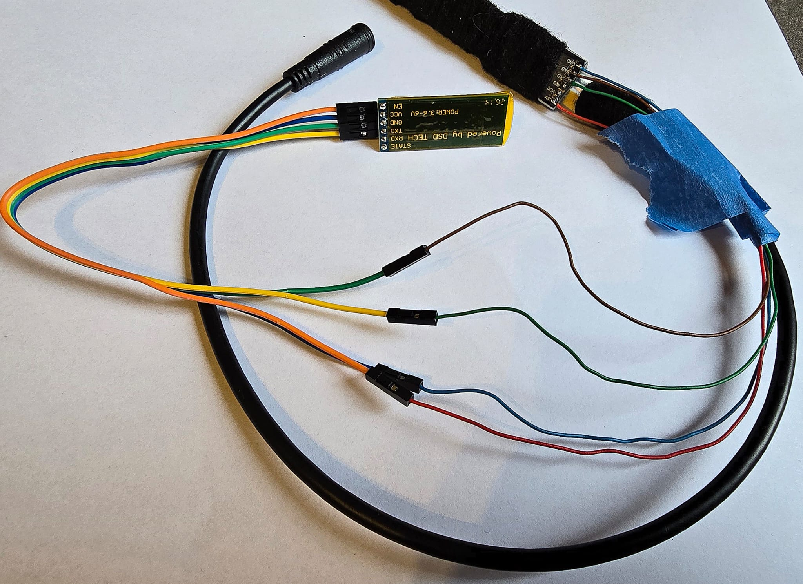
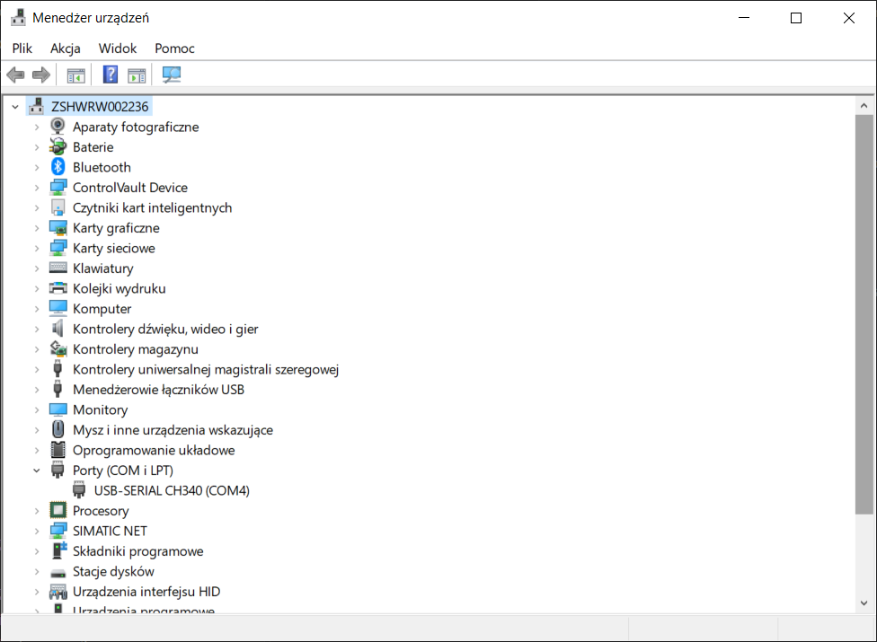
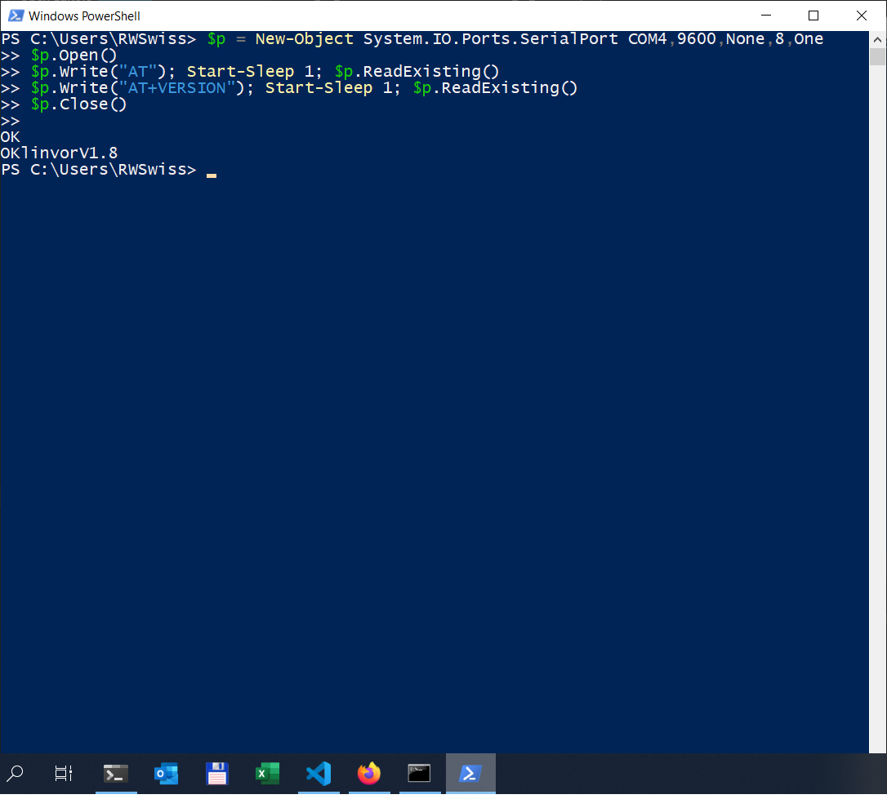
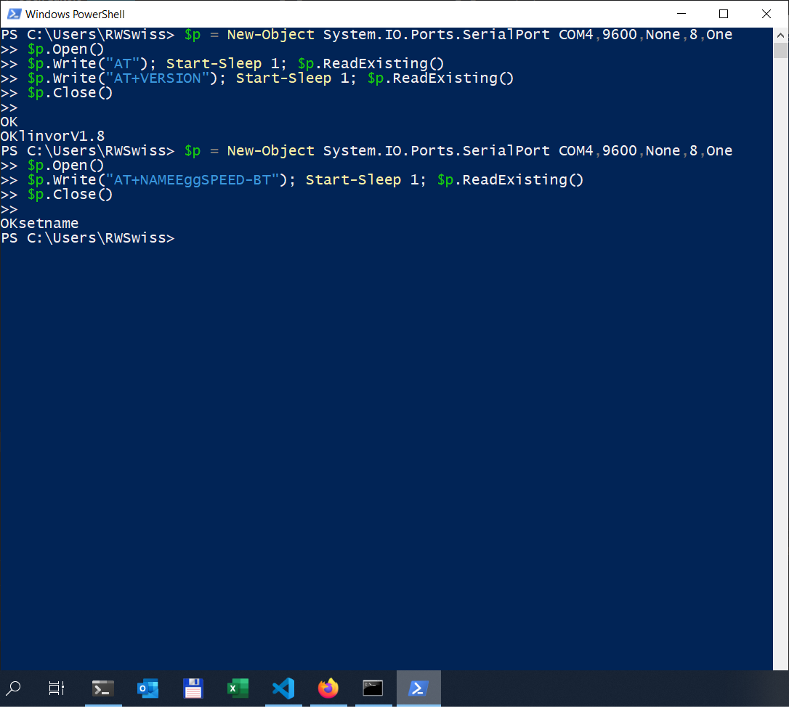
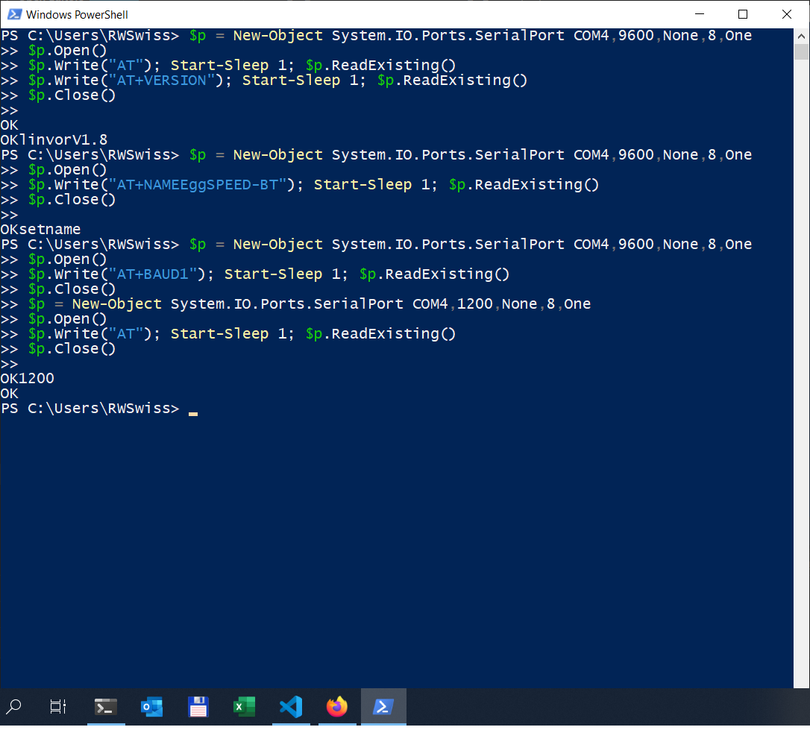
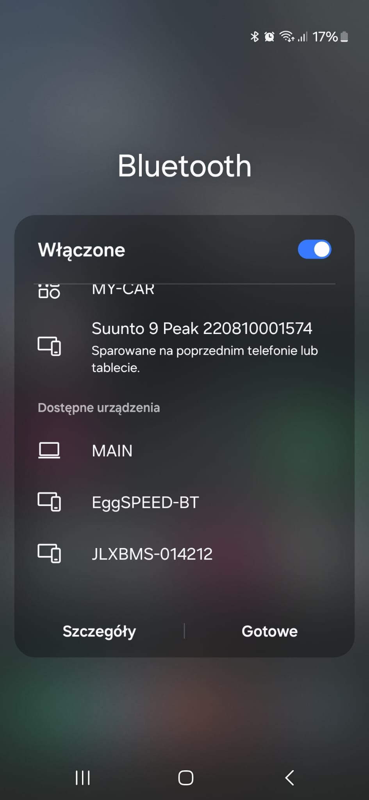

# Manual 1 - Program the BT-06 with the OTG cable

Before the BT-06 module can talk to a Bafang controller, it has to be set to **1200 baud**
(factory default is 9600). This is done once, from a Windows PC, using the same USB
programming cable (OTG cable) you already use for your Bafang. No extra programs are needed,
only Windows PowerShell.

Do this **before** soldering the module into the converter.

Tested on: DSD TECH BT-06, firmware `linvorV1.8`, Windows 10.

[Back to the build guide](../README.md)

## What you need

- DSD TECH BT-06 module
- Bafang programming cable (USB-UART board with a CH340 chip, set to 3.3V logic)
- 4 jumper wires (Dupont)
- Windows PC

## 1. Wiring

The BT-06 board has 6 pins (EN, VCC, GND, TXD, RXD, STATE). Only the 4 middle ones are used.

To reach the pins of the cable board, open the cable housing - the pins are labeled on the board.

```
 OTG CABLE BOARD      BT-06
 ---------------      -----
   5V  ─────────────  VCC
   GND ─────────────  GND
   TXD ─────────────  RXD
   RXD ─────────────  TXD

 (VCC and 3V3 on the cable board: not connected)
 (EN and STATE on the BT-06: not connected)
```

TX and RX are crossed: what one side sends (TXD), the other side receives (RXD).
The module VCC goes to the **5V** pin of the cable board (the BT-06 needs 3.6-6V).





After power-up the LED on the BT-06 blinks: the module is not paired and accepts AT commands.
Do not pair it with a phone during the setup.

## 2. Check the COM port

Plug the cable into the PC and open **Device Manager** (right-click Start > Device Manager).
Under **Ports (COM & LPT)** you should see **USB-SERIAL CH340 (COMx)**. Note the number.

If the port does not show up, install the CH340 driver (`CH341SER.EXE`) from the chip
manufacturer WCH (wch-ic.com) and plug the cable in again.



In the commands below the port is `COM4`. If yours has a different number, change `COM4`
in every command.

## 3. Open PowerShell

Press **Win + R**, type `powershell`, press **Enter**.

Wait until the PowerShell window is fully loaded (the `PS C:\...>` prompt is shown) before pasting.

How to paste each block below: copy the whole block, right-click in the PowerShell window to
paste, then press **Enter twice** (after the paste PowerShell waits at `>>`).

## 4. Test the connection

```powershell
$p = New-Object System.IO.Ports.SerialPort COM4,9600,None,8,One
$p.Open()
$p.Write("AT"); Start-Sleep 1; $p.ReadExisting()
$p.Write("AT+VERSION"); Start-Sleep 1; $p.ReadExisting()
$p.Close()
```

Expected result:

```
OK
OKlinvorV1.8
```

The version may differ. The first answer must be `OK`. No answer at all usually means TX and RX
are not crossed, or the COM number is wrong.



## 5. Set the name

The name is what your phone shows when it scans for Bluetooth devices.

```powershell
$p = New-Object System.IO.Ports.SerialPort COM4,9600,None,8,One
$p.Open()
$p.Write("AT+NAMEEggSPEED-BT"); Start-Sleep 1; $p.ReadExisting()
$p.Close()
```

Expected result:

```
OKsetname
```



## 6. Change the PIN (optional, recommended)

The factory pairing PIN is `1234`. Anyone nearby who knows it can pair with the converter while
the battery is on. To set your own 4-digit PIN (here `4711`):

```powershell
$p = New-Object System.IO.Ports.SerialPort COM4,9600,None,8,One
$p.Open()
$p.Write("AT+PIN4711"); Start-Sleep 1; $p.ReadExisting()
$p.Close()
```

Expected result: `OKsetPIN`. Write the new PIN down - you need it when pairing the phone.

## 7. Set 1200 baud and check it

Do this step last: after it, the module only answers at 1200 baud.

```powershell
$p = New-Object System.IO.Ports.SerialPort COM4,9600,None,8,One
$p.Open()
$p.Write("AT+BAUD1"); Start-Sleep 1; $p.ReadExisting()
$p.Close()
$p = New-Object System.IO.Ports.SerialPort COM4,1200,None,8,One
$p.Open()
$p.Write("AT"); Start-Sleep 1; $p.ReadExisting()
$p.Close()
```

Expected result:

```
OK1200
OK
```

The second `OK` already comes at 1200 baud, which confirms the change.



## 8. Check on the phone

Open Bluetooth on your phone and scan. The module shows up under the new name **EggSPEED-BT**.
You do not have to pair it yet - that is done after the converter is built.



## Notes

- All settings are stored in the module and stay after power-off.
- From now on the module talks **only at 1200 baud**. Any later AT command must use `1200`
  instead of `9600` in the first line of the block.
- AT commands work only while the module is **not paired/connected** (LED blinking).
- If the COM port disappears (commands fail with "port does not exist"), unplug the cable,
  check the wiring and plug it in again.
- Use PowerShell, not `cmd`: `cmd` does not understand these commands.
- Generic HC-06 boards from other makers use the same commands, but their firmware varies. If a
  module does not answer `OK` to `AT`, try another unit before looking for a wiring fault.

Next: build the converter - see the [build guide](../README.md#step-2-build-the-converter).
