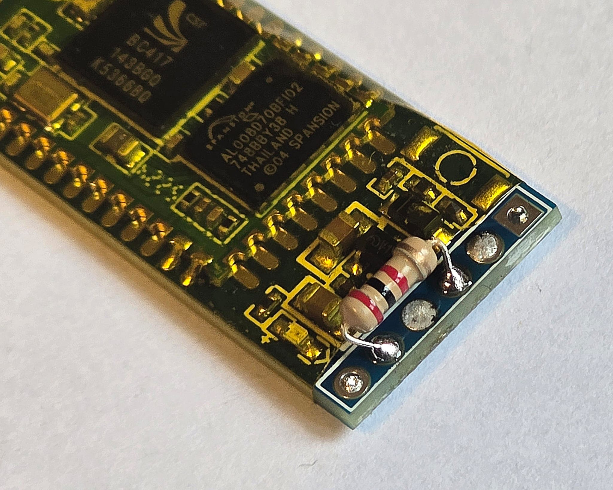
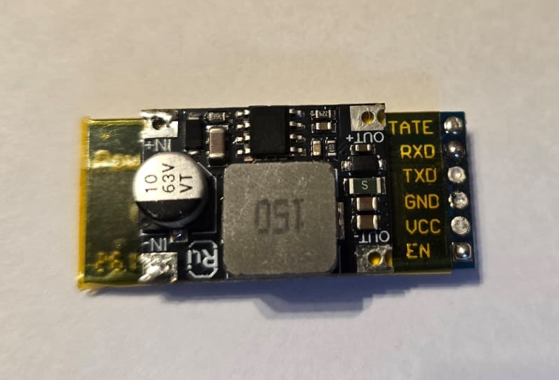
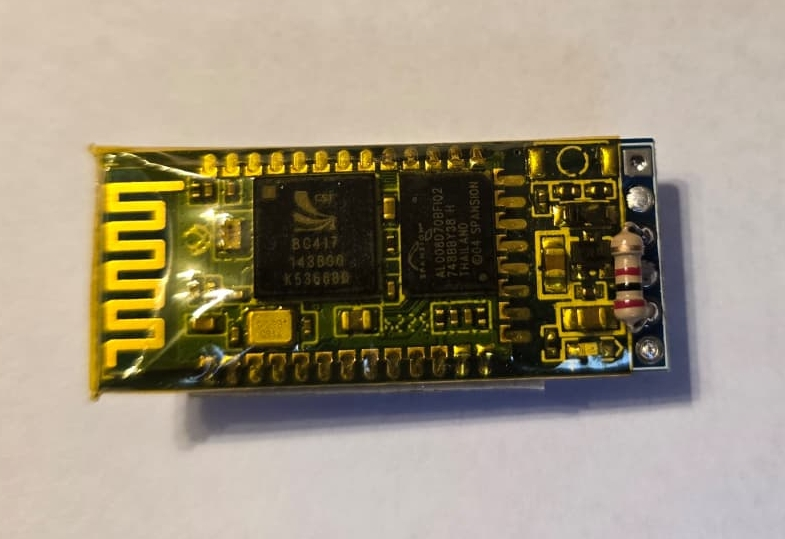
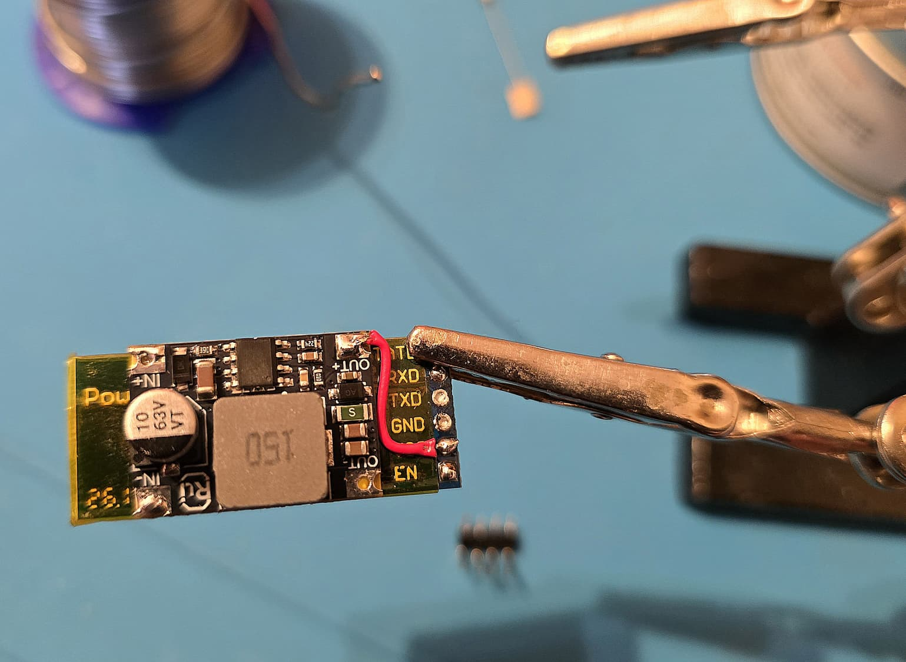
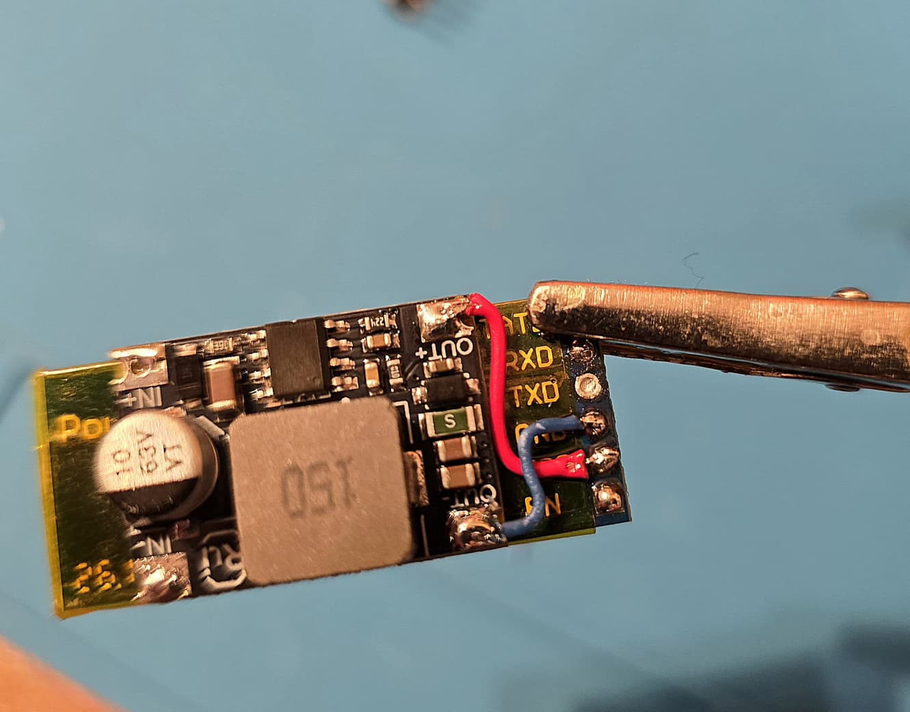
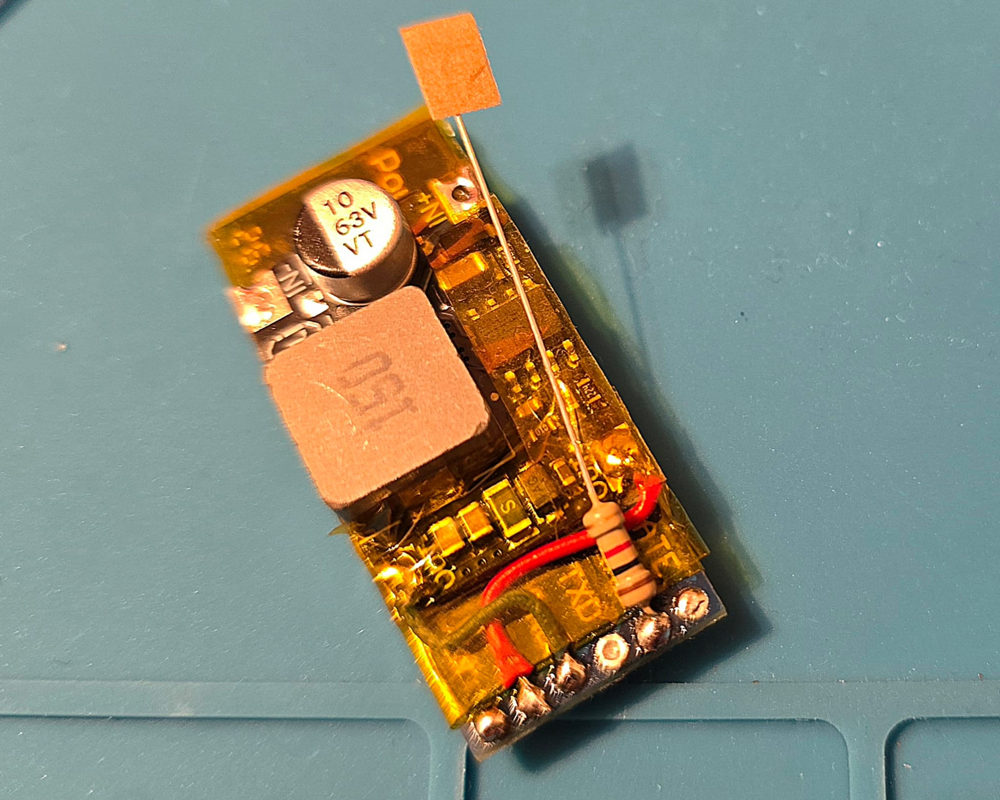
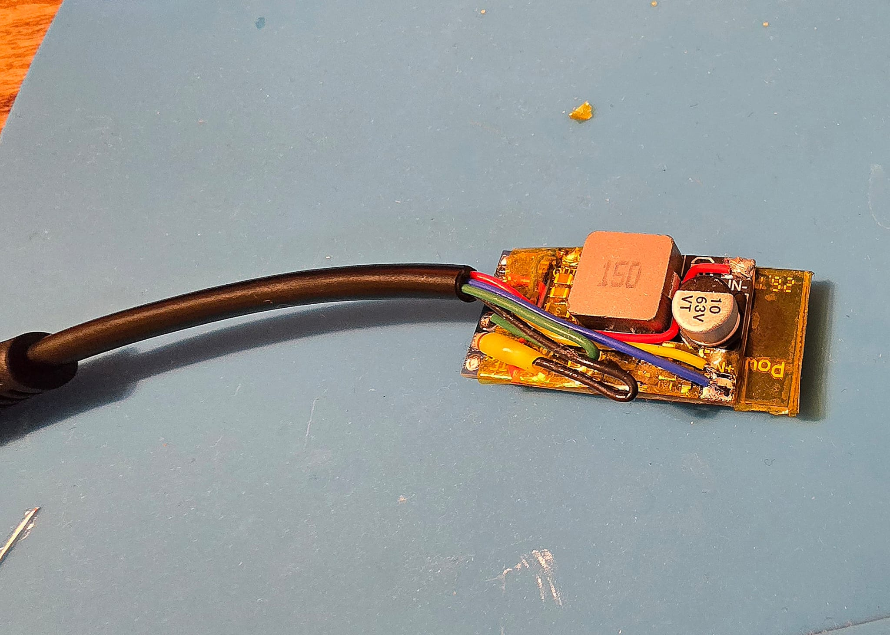
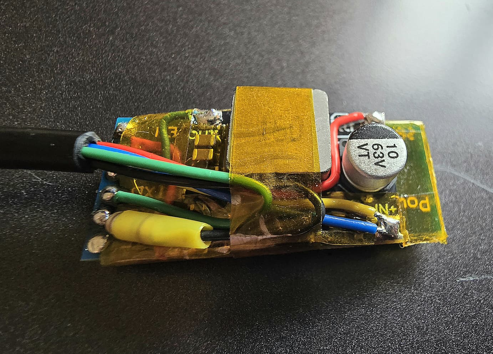
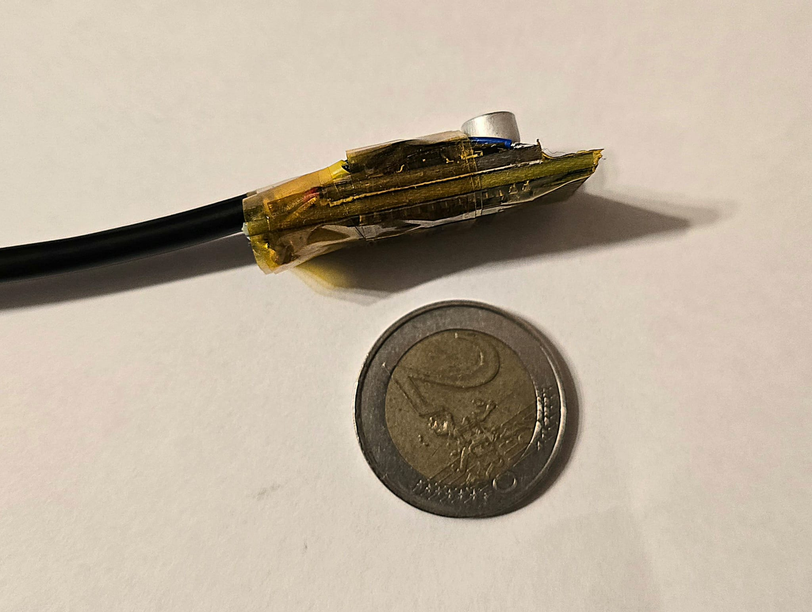

# Manual 2 - Build and solder the converter

This manual shows how the converter was built, step by step. The step-down converter sits on
the back of the BT-06 module, so the whole thing ends up only a little bigger than the module
itself.

Program the BT-06 first ([Manual 1](01-program-bt06.md)) - after soldering, its pins are no
longer reachable for the programming cable.

[Back to the build guide](../README.md) - the wiring diagram and the HIGO pinout are there.

## Before you start: wire colors

**Go by HIGO pin numbers, never by wire colors.** Cables with HIGO plugs use different wire
colors - on the cable used here, GND is red. Before soldering, check every wire with a multimeter
(continuity) against the pin numbers in the [HIGO pinout](../README.md#higo-pinout-controller-side),
and mark each wire with its pin number (a piece of tape is enough).

## 1. Parts

From left: a cable with a HIGO 5-pin plug, the two divider resistors (10kΩ and 22kΩ), the
step-down converter (5-60V in, 5V out) and the BT-06 module.

## 2. Remove the pin header from the module

Desolder the 4-pin header from the BT-06. The wires are soldered straight to the pads, which
keeps the converter small. The pads on the back are labeled STATE, RXD, TXD, GND, VCC, EN - only
RXD, TXD, GND and VCC are used.

## 3. R2 between RXD and GND

Solder **R2 (22kΩ)** on the back of the module between the **RXD** and **GND** pads. Keep the
leads short.

## 4. Insulate the module and fit the step-down converter

Wrap the module in Kapton tape, leaving the pads free. Stick the step-down converter onto the
back of the module, with Kapton tape between them so no contacts touch.

## 5. Module power: OUT+ to VCC

A short wire from the step-down **OUT+** to the module **VCC** pad.

## 6. Module ground: OUT- to GND

A short wire from the step-down **OUT-** to the module **GND** pad.

## 7. R1 on the RXD pad

Solder one lead of **R1 (10kΩ)** to the module **RXD** pad (the same pad R2 goes to). The other
lead will take the wire from HIGO pin 2 (TxD).

## 8. The HIGO cable

Solder the cable wires, **by pin number**:

| HIGO pin | Goes to |
|---|---|
| 3 (P+) **and** 5 (PL) | soldered together, to step-down **IN+** |
| 1 (GND) | step-down **IN-** |
| 2 (TxD) | free lead of **R1** - cover R1 and the joint with heat-shrink tubing |
| 4 (RxD) | module **TXD** pad, directly |

## 9. Check before the first power-up

With the converter **not** plugged in:

- **No short** between step-down IN+ and IN- (multimeter in continuity mode: no beep). This is
  the battery voltage - a short here would short the battery voltage on the controller connector.
- **No short** between the HIGO pins: test every pin against every other pin. Only pin 3 and
  pin 5 may beep (they are soldered together).
- **R1 and R2 in place:** between HIGO pin 2 and the module RXD pad you should measure R1
  (about 10kΩ); between the RXD and GND pads about 22kΩ in parallel with the module input
  (somewhat less than 22kΩ is normal).

## 10. First power-up

1. Plug the converter into the controller (battery connected). The controller wakes up and the
   BT-06 LED starts blinking.
2. Measure against GND (HIGO pin 1 / module GND):
   - module **VCC**: about **5V**;
   - module **RXD**: about **2.5-3.3V** (see [The divider](../README.md#the-divider));
   - module **TXD**: about **3.3V**.
3. Pair the phone and connect EggSPEED - see [Step 3](../README.md#step-3-connect-eggspeed) in
   the build guide.

## 11. Insulate

When everything works, wrap the whole converter in Kapton tape, including the cable end, so
nothing can touch anything else.

## 12. Enclosure (optional)

A small 3D-printed enclosure with the EggSPEED name on the lid, closed with two screws, protects
the converter on the bike. The print file will be linked here.

